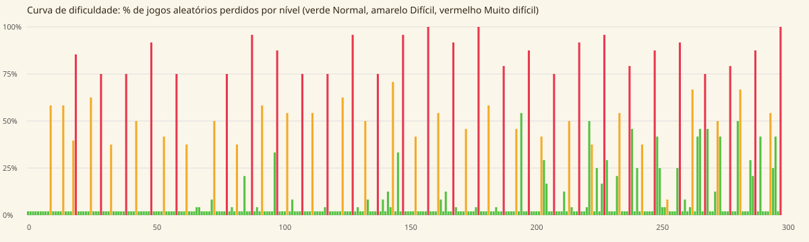

# Relatório dos níveis

Gerado por `npm run levels:report`.

## Resumo

| Etiqueta | Níveis |
|---|---|
| Normal | 241 |
| Difícil | 31 |
| Muito difícil | 28 |

- Todos os 300 níveis são resolúveis com 5 ranhuras (a solução está guardada e é testada).
- Normal: a estratégia gulosa ganha. Difícil: a gulosa perde e 35-74% dos jogos aleatórios perdem. Muito difícil: a gulosa perde e 75%+ dos jogos aleatórios perdem.
- Níveis que não atingiram a dificuldade pretendida (ficaram com a etiqueta real medida): 70 (pretendido Muito difícil, ficou Normal).

## Por dezena

| Níveis | Tamanho médio | Blocos (média) | Peças (média) | Normal | Difícil | Muito difícil |
|---|---|---|---|---|---|---|
| 1-10 | 16x16 | 256 | 11 | 9 | 1 | 0 |
| 11-20 | 16x16 | 256 | 13 | 7 | 2 | 1 |
| 21-30 | 17x17 | 302 | 15 | 8 | 1 | 1 |
| 31-40 | 18x18 | 349 | 16 | 8 | 1 | 1 |
| 41-50 | 19x20 | 402 | 20 | 8 | 1 | 1 |
| 51-60 | 20x20 | 406 | 19 | 8 | 1 | 1 |
| 61-70 | 20x20 | 421 | 19 | 9 | 1 | 0 |
| 71-80 | 22x22 | 470 | 21 | 8 | 1 | 1 |
| 81-90 | 22x23 | 523 | 25 | 8 | 1 | 1 |
| 91-100 | 24x24 | 585 | 27 | 8 | 1 | 1 |
| 101-110 | 25x25 | 636 | 29 | 8 | 1 | 1 |
| 111-120 | 25x26 | 655 | 30 | 8 | 1 | 1 |
| 121-130 | 26x27 | 708 | 31 | 8 | 1 | 1 |
| 131-140 | 27x29 | 786 | 34 | 8 | 1 | 1 |
| 141-150 | 28x29 | 812 | 35 | 8 | 1 | 1 |
| 151-160 | 28x30 | 872 | 38 | 8 | 1 | 1 |
| 161-170 | 29x31 | 925 | 42 | 8 | 1 | 1 |
| 171-180 | 30x33 | 999 | 44 | 8 | 1 | 1 |
| 181-190 | 31x34 | 1059 | 45 | 8 | 1 | 1 |
| 191-200 | 32x34 | 1084 | 47 | 8 | 1 | 1 |
| 201-210 | 33x35 | 1158 | 50 | 8 | 1 | 1 |
| 211-220 | 34x36 | 1226 | 52 | 8 | 1 | 1 |
| 221-230 | 35x38 | 1331 | 55 | 8 | 1 | 1 |
| 231-240 | 35x39 | 1366 | 56 | 8 | 1 | 1 |
| 241-250 | 36x40 | 1434 | 58 | 8 | 1 | 1 |
| 251-260 | 37x41 | 1501 | 60 | 8 | 1 | 1 |
| 261-270 | 37x41 | 1536 | 62 | 8 | 1 | 1 |
| 271-280 | 38x42 | 1632 | 63 | 8 | 1 | 1 |
| 281-290 | 39x43 | 1696 | 61 | 8 | 1 | 1 |
| 291-300 | 39x43 | 1696 | 60 | 8 | 1 | 1 |

## Todos os níveis

| Nível | Arte | Tamanho | Cores | Peças | Etiqueta | Gulosa ganha | Derrota aleatória | Obstáculos |
|---|---|---|---|---|---|---|---|---|
| 1 | coracao | 16x16 | 2 | 8 | Normal | sim | 0% | - |
| 2 | sol | 16x16 | 3 | 9 | Normal | sim | 0% | - |
| 3 | folha | 16x16 | 3 | 9 | Normal | sim | 0% | - |
| 4 | cogumelo | 16x16 | 4 | 10 | Normal | sim | 0% | - |
| 5 | abelha | 16x16 | 4 | 10 | Normal | sim | 0% | - |
| 6 | flor | 16x16 | 4 | 11 | Normal | sim | 0% | - |
| 7 | maca | 16x16 | 5 | 11 | Normal | sim | 0% | - |
| 8 | peixe | 16x16 | 5 | 11 | Normal | sim | 0% | - |
| 9 | estrela | 16x16 | 4 | 10 | Normal | sim | 0% | - |
| 10 | casa | 16x16 | 6 | 16 | Difícil | não | 58% | - |
| 11 | borboleta | 16x16 | 5 | 11 | Normal | sim | 0% | gémeas |
| 12 | cerejas | 16x16 | 4 | 11 | Normal | sim | 0% | gémeas |
| 13 | gelado | 16x16 | 5 | 12 | Normal | sim | 0% | gémeas |
| 14 | pote | 16x16 | 5 | 11 | Normal | sim | 0% | gémeas |
| 15 | gato | 16x16 | 5 | 14 | Difícil | não | 58% | gémeas |
| 16 | caracol | 16x16 | 5 | 12 | Normal | sim | 0% | gémeas |
| 17 | arvore | 16x16 | 5 | 12 | Normal | sim | 0% | gémeas |
| 18 | lua | 16x16 | 4 | 11 | Normal | sim | 0% | gémeas |
| 19 | queque | 16x16 | 6 | 14 | Difícil | não | 40% | gémeas |
| 20 | colmeia | 16x16 | 6 | 18 | Muito difícil | não | 85% | gémeas |
| 21 | caracol | 16x16 | 4 | 13 | Normal | sim | 0% | gémeas |
| 22 | sol | 16x16 | 3 | 10 | Normal | sim | 0% | tubos |
| 23 | mocho | 16x16 | 4 | 12 | Normal | sim | 0% | gémeas |
| 24 | ananas | 16x16 | 3 | 11 | Normal | sim | 0% | gémeas, tubos |
| 25 | morango | 16x16 | 3 | 10 | Normal | sim | 0% | tubos |
| 26 | lua | 20x20 | 3 | 23 | Difícil | não | 63% | gémeas |
| 27 | rosa | 16x16 | 4 | 12 | Normal | sim | 0% | gémeas, tubos |
| 28 | lotus | 16x16 | 4 | 11 | Normal | sim | 0% | gémeas |
| 29 | cerejas | 16x16 | 3 | 9 | Normal | sim | 0% | tubos |
| 30 | girassol | 24x24 | 5 | 36 | Muito difícil | não | 75% | gémeas, tubos |
| 31 | bolo | 16x16 | 4 | 12 | Normal | sim | 0% | gémeas, pedras |
| 32 | rebucado | 16x16 | 4 | 12 | Normal | sim | 0% | gémeas, tubos, pedras |
| 33 | peixe | 20x20 | 3 | 14 | Normal | sim | 0% | gémeas, pedras |
| 34 | uvas | 24x24 | 3 | 28 | Difícil | não | 38% | gémeas, tubos, pedras |
| 35 | joaninha | 16x16 | 3 | 11 | Normal | sim | 0% | gémeas, tubos, pedras |
| 36 | tulipa | 16x16 | 3 | 9 | Normal | sim | 0% | gémeas, pedras |
| 37 | pera | 16x16 | 2 | 11 | Normal | sim | 0% | gémeas, pedras |
| 38 | folha-outono | 16x16 | 3 | 11 | Normal | sim | 0% | gémeas, pedras |
| 39 | gato | 20x20 | 4 | 18 | Normal | sim | 0% | gémeas, tubos, pedras |
| 40 | pote-mel | 24x24 | 4 | 38 | Muito difícil | não | 75% | gémeas, tubos, pedras |
| 41 | cogumelo | 16x16 | 4 | 11 | Normal | sim | 0% | gémeas, tubos, pedras, escondidas |
| 42 | arvore | 20x20 | 4 | 16 | Normal | sim | 0% | gémeas, escondidas |
| 43 | passaro | 16x16 | 5 | 14 | Normal | sim | 0% | gémeas, escondidas |
| 44 | maca | 28x30 | 5 | 44 | Difícil | não | 50% | gémeas, pedras, escondidas |
| 45 | lavanda | 16x16 | 4 | 13 | Normal | sim | 0% | gémeas, pedras, escondidas |
| 46 | queque | 16x16 | 3 | 10 | Normal | sim | 0% | gémeas, escondidas |
| 47 | donut | 20x20 | 3 | 15 | Normal | sim | 0% | gémeas, pedras, escondidas |
| 48 | arco-iris | 16x16 | 6 | 11 | Normal | sim | 0% | gémeas, tubos, escondidas |
| 49 | boneco-neve | 16x16 | 3 | 13 | Normal | sim | 0% | gémeas, escondidas |
| 50 | cabana | 28x30 | 6 | 50 | Muito difícil | não | 92% | gémeas, tubos, escondidas |
| 51 | vaso | 20x20 | 6 | 17 | Normal | sim | 0% | gémeas, tubos, escondidas |
| 52 | limao | 20x20 | 3 | 17 | Normal | sim | 0% | tubos, pedras, escondidas |
| 53 | chapeu-chuva | 20x20 | 4 | 16 | Normal | sim | 0% | gémeas, pedras, escondidas |
| 54 | floco | 16x16 | 3 | 13 | Normal | sim | 0% | gémeas, tubos, escondidas |
| 55 | chupa | 24x24 | 3 | 30 | Difícil | não | 42% | gémeas, tubos, pedras, escondidas |
| 56 | laranja | 20x20 | 4 | 16 | Normal | sim | 0% | escondidas |
| 57 | borboleta | 16x16 | 4 | 12 | Normal | sim | 0% | tubos, pedras, escondidas |
| 58 | sapo | 20x20 | 4 | 17 | Normal | sim | 0% | gémeas, escondidas |
| 59 | malmequer | 20x20 | 5 | 16 | Normal | sim | 0% | gémeas, tubos, escondidas |
| 60 | favos | 24x24 | 2 | 36 | Muito difícil | não | 75% | gémeas, tubos, pedras, escondidas |
| 61 | abelha | 20x20 | 4 | 16 | Normal | sim | 0% | gémeas, tubos, escondidas, flores |
| 62 | gelado | 16x16 | 4 | 11 | Normal | sim | 0% | tubos, escondidas, flores |
| 63 | melancia | 20x20 | 4 | 19 | Normal | sim | 0% | gémeas, tubos, escondidas, flores |
| 64 | colmeia | 24x24 | 4 | 29 | Difícil | não | 38% | gémeas, tubos, pedras, escondidas, flores |
| 65 | bolacha | 20x20 | 3 | 17 | Normal | sim | 0% | pedras, escondidas |
| 66 | folha-outono | 20x20 | 3 | 15 | Normal | sim | 0% | gémeas, pedras, escondidas, flores |
| 67 | caracol | 20x20 | 4 | 16 | Normal | sim | 0% | tubos, escondidas |
| 68 | ananas | 20x20 | 4 | 15 | Normal | sim | 4% | gémeas, tubos, pedras, flores |
| 69 | donut | 20x20 | 3 | 18 | Normal | sim | 4% | tubos, pedras, escondidas, flores |
| 70 | pera | 24x24 | 4 | 35 | Normal | sim | 0% | gémeas, tubos, escondidas |
| 71 | cogumelo | 20x20 | 4 | 17 | Normal | sim | 0% | gémeas, tubos, pedras, escondidas |
| 72 | bolacha | 20x20 | 3 | 15 | Normal | sim | 0% | gémeas, escondidas, flores |
| 73 | sapo | 20x20 | 4 | 17 | Normal | sim | 0% | gémeas, tubos, pedras, escondidas |
| 74 | malmequer | 24x24 | 5 | 22 | Normal | sim | 8% | gémeas, tubos, pedras, escondidas, flores |
| 75 | gato | 24x24 | 4 | 31 | Difícil | não | 50% | gémeas, tubos, escondidas, flores |
| 76 | arco-iris | 20x20 | 7 | 17 | Normal | sim | 0% | gémeas, tubos, pedras, escondidas |
| 77 | chupa | 20x20 | 3 | 16 | Normal | sim | 0% | tubos, pedras, escondidas, flores |
| 78 | favos | 20x20 | 2 | 15 | Normal | sim | 0% | tubos, pedras, escondidas, flores |
| 79 | cerejas | 24x24 | 4 | 23 | Normal | sim | 0% | gémeas, tubos, pedras, escondidas |
| 80 | bolo | 24x24 | 5 | 34 | Muito difícil | não | 75% | gémeas, escondidas, flores |
| 81 | rebucado | 20x20 | 4 | 17 | Normal | sim | 0% | tubos, escondidas |
| 82 | boneco-neve | 24x24 | 4 | 24 | Normal | sim | 4% | gémeas, tubos, pedras, escondidas, flores |
| 83 | vaso | 20x20 | 6 | 16 | Normal | sim | 0% | gémeas, tubos, escondidas |
| 84 | lua | 28x30 | 3 | 48 | Difícil | não | 38% | gémeas, tubos, escondidas, flores |
| 85 | gelado | 20x20 | 5 | 15 | Normal | sim | 0% | escondidas, flores |
| 86 | joaninha | 20x20 | 3 | 16 | Normal | sim | 0% | gémeas, tubos, escondidas |
| 87 | borboleta | 24x24 | 5 | 23 | Normal | sim | 21% | gémeas, tubos, pedras, escondidas |
| 88 | passaro | 20x20 | 4 | 16 | Normal | sim | 0% | gémeas, tubos, pedras, escondidas, flores |
| 89 | sol | 20x20 | 4 | 17 | Normal | sim | 0% | gémeas, tubos, pedras, escondidas, flores |
| 90 | melancia | 28x30 | 5 | 53 | Muito difícil | não | 96% | gémeas, tubos, pedras, escondidas |
| 91 | mocho | 24x24 | 5 | 24 | Normal | sim | 0% | tubos, pedras, escondidas |
| 92 | chapeu-chuva | 24x24 | 5 | 22 | Normal | sim | 4% | gémeas, tubos, escondidas, flores |
| 93 | uvas | 24x24 | 3 | 22 | Normal | sim | 0% | gémeas, tubos, escondidas, flores |
| 94 | peixe | 24x24 | 3 | 31 | Difícil | não | 58% | gémeas, tubos, escondidas, flores |
| 95 | lotus | 24x24 | 4 | 23 | Normal | sim | 0% | gémeas, tubos, escondidas, flores |
| 96 | queque | 24x24 | 5 | 26 | Normal | sim | 0% | gémeas, tubos, escondidas, flores |
| 97 | morango | 20x20 | 3 | 17 | Normal | sim | 0% | gémeas, tubos, escondidas, flores |
| 98 | colmeia | 24x24 | 4 | 25 | Normal | sim | 0% | gémeas, pedras, escondidas |
| 99 | girassol | 24x24 | 5 | 23 | Normal | sim | 33% | gémeas, tubos, escondidas, flores |
| 100 | laranja | 28x30 | 4 | 53 | Muito difícil | não | 88% | gémeas, tubos, pedras, escondidas, flores |
| 101 | pote-mel | 24x24 | 4 | 22 | Normal | sim | 0% | gémeas, pedras, escondidas, flores |
| 102 | maca | 20x20 | 4 | 16 | Normal | sim | 0% | gémeas, tubos, escondidas |
| 103 | cabana | 24x24 | 6 | 24 | Normal | sim | 0% | gémeas, tubos, escondidas |
| 104 | floco | 28x30 | 3 | 47 | Difícil | não | 54% | gémeas, tubos, pedras, escondidas |
| 105 | tulipa | 24x24 | 4 | 21 | Normal | sim | 0% | gémeas, escondidas, flores |
| 106 | abelha | 24x24 | 4 | 23 | Normal | sim | 8% | gémeas, tubos, pedras, escondidas, flores |
| 107 | limao | 24x24 | 4 | 24 | Normal | sim | 0% | gémeas, tubos, escondidas |
| 108 | rosa | 24x24 | 4 | 25 | Normal | sim | 0% | gémeas, tubos, escondidas, flores |
| 109 | lavanda | 24x24 | 5 | 22 | Normal | sim | 0% | gémeas, tubos, pedras, escondidas |
| 110 | arvore | 32x34 | 4 | 67 | Muito difícil | não | 75% | gémeas, tubos, pedras, escondidas, flores |
| 111 | pera | 24x24 | 4 | 25 | Normal | sim | 0% | gémeas, tubos, escondidas |
| 112 | floco | 24x24 | 3 | 24 | Normal | sim | 0% | gémeas, tubos, escondidas |
| 113 | lavanda | 24x24 | 5 | 21 | Normal | sim | 0% | gémeas, escondidas |
| 114 | morango | 28x30 | 4 | 46 | Difícil | não | 54% | gémeas, tubos, pedras, escondidas |
| 115 | boneco-neve | 24x24 | 4 | 25 | Normal | sim | 0% | gémeas, tubos, pedras, escondidas |
| 116 | tulipa | 24x24 | 4 | 23 | Normal | sim | 0% | gémeas, tubos, pedras, escondidas |
| 117 | joaninha | 24x24 | 3 | 22 | Normal | sim | 0% | gémeas, tubos, escondidas, flores |
| 118 | queque | 24x24 | 5 | 23 | Normal | sim | 0% | gémeas, pedras, escondidas, flores |
| 119 | rosa | 28x30 | 4 | 34 | Normal | sim | 4% | gémeas, tubos, pedras, escondidas, flores |
| 120 | sol | 28x30 | 5 | 56 | Muito difícil | não | 75% | gémeas, tubos, pedras, escondidas |
| 121 | limao | 24x24 | 4 | 20 | Normal | sim | 0% | gémeas, pedras, escondidas, flores |
| 122 | donut | 28x30 | 3 | 35 | Normal | sim | 0% | gémeas, tubos, escondidas, flores |
| 123 | uvas | 24x24 | 3 | 24 | Normal | sim | 0% | gémeas, tubos, escondidas, flores |
| 124 | lua | 28x30 | 3 | 36 | Normal | sim | 0% | gémeas, tubos, pedras, escondidas, flores |
| 125 | arvore | 24x24 | 4 | 24 | Normal | sim | 0% | tubos, escondidas |
| 126 | cabana | 28x30 | 6 | 44 | Difícil | não | 63% | gémeas, tubos, pedras, escondidas |
| 127 | chapeu-chuva | 28x30 | 5 | 32 | Normal | sim | 0% | tubos, escondidas |
| 128 | colmeia | 24x24 | 4 | 22 | Normal | sim | 0% | gémeas, tubos, pedras, escondidas, flores |
| 129 | cogumelo | 24x24 | 4 | 23 | Normal | sim | 0% | gémeas, escondidas, flores |
| 130 | lotus | 28x30 | 5 | 53 | Muito difícil | não | 96% | gémeas, tubos, pedras, escondidas, flores |
| 131 | sapo | 28x30 | 4 | 32 | Normal | sim | 0% | gémeas, tubos, escondidas, flores |
| 132 | abelha | 28x30 | 4 | 34 | Normal | sim | 4% | gémeas, tubos, pedras, escondidas |
| 133 | maca | 28x30 | 5 | 32 | Normal | sim | 0% | gémeas, tubos, pedras, escondidas |
| 134 | girassol | 24x24 | 5 | 24 | Normal | sim | 0% | gémeas, tubos, pedras, escondidas |
| 135 | gelado | 28x30 | 5 | 46 | Difícil | não | 50% | gémeas, tubos, pedras, escondidas |
| 136 | favos | 28x30 | 2 | 32 | Normal | sim | 8% | gémeas, tubos, escondidas, flores |
| 137 | melancia | 24x24 | 4 | 21 | Normal | sim | 0% | gémeas, pedras, escondidas, flores |
| 138 | chupa | 24x24 | 3 | 22 | Normal | sim | 0% | gémeas, tubos, pedras, escondidas, flores |
| 139 | arco-iris | 28x30 | 8 | 34 | Normal | sim | 0% | gémeas, escondidas |
| 140 | laranja | 32x34 | 4 | 66 | Muito difícil | não | 75% | gémeas, tubos, pedras, escondidas, flores |
| 141 | passaro | 28x30 | 6 | 33 | Normal | sim | 0% | gémeas, tubos, escondidas |
| 142 | borboleta | 24x24 | 5 | 23 | Normal | sim | 8% | gémeas, pedras, escondidas |
| 143 | pote-mel | 24x24 | 4 | 23 | Normal | sim | 0% | gémeas, tubos, pedras, escondidas |
| 144 | bolo | 28x30 | 5 | 35 | Normal | sim | 13% | gémeas, tubos, pedras, escondidas, flores |
| 145 | rebucado | 28x30 | 4 | 29 | Normal | sim | 4% | gémeas, tubos, pedras, escondidas, flores |
| 146 | ananas | 28x30 | 4 | 43 | Difícil | não | 71% | gémeas, tubos, escondidas, flores |
| 147 | gato | 28x30 | 4 | 35 | Normal | sim | 0% | gémeas, tubos, pedras, escondidas |
| 148 | peixe | 28x30 | 4 | 35 | Normal | sim | 33% | gémeas, tubos, escondidas |
| 149 | cerejas | 28x30 | 4 | 31 | Normal | sim | 0% | gémeas, tubos, escondidas, flores |
| 150 | folha-outono | 32x34 | 3 | 66 | Muito difícil | não | 96% | gémeas, tubos, escondidas |
| 151 | caracol | 24x24 | 4 | 23 | Normal | sim | 0% | gémeas, pedras, escondidas, flores |
| 152 | mocho | 28x30 | 5 | 33 | Normal | sim | 0% | gémeas, tubos, escondidas |
| 153 | malmequer | 28x30 | 5 | 34 | Normal | sim | 0% | gémeas, tubos, pedras, escondidas, flores |
| 154 | bolacha | 24x24 | 3 | 21 | Normal | sim | 0% | gémeas, tubos, pedras, escondidas |
| 155 | vaso | 32x34 | 8 | 55 | Difícil | não | 42% | gémeas, tubos, pedras, escondidas, flores |
| 156 | cogumelo | 28x30 | 4 | 34 | Normal | sim | 0% | gémeas, tubos, pedras, escondidas |
| 157 | bolo | 28x30 | 5 | 33 | Normal | sim | 0% | gémeas, tubos, pedras, escondidas |
| 158 | girassol | 28x30 | 5 | 32 | Normal | sim | 0% | gémeas, tubos, escondidas |
| 159 | chupa | 28x30 | 3 | 31 | Normal | sim | 0% | tubos, escondidas |
| 160 | maca | 36x40 | 5 | 83 | Muito difícil | não | 100% | gémeas, tubos, escondidas |
| 161 | passaro | 28x30 | 6 | 33 | Normal | sim | 0% | gémeas, tubos, pedras, escondidas |
| 162 | pote-mel | 28x30 | 4 | 34 | Normal | sim | 0% | gémeas, tubos, escondidas, flores |
| 163 | ananas | 28x30 | 4 | 33 | Normal | sim | 0% | gémeas, tubos, pedras, escondidas |
| 164 | colmeia | 36x40 | 4 | 77 | Difícil | não | 54% | gémeas, tubos, escondidas, flores |
| 165 | lotus | 28x30 | 5 | 34 | Normal | sim | 8% | gémeas, tubos, pedras, escondidas |
| 166 | lua | 28x30 | 3 | 34 | Normal | sim | 0% | gémeas, pedras, escondidas, flores |
| 167 | rebucado | 28x30 | 4 | 36 | Normal | sim | 13% | gémeas, escondidas, flores |
| 168 | uvas | 28x30 | 4 | 32 | Normal | sim | 0% | gémeas, tubos, pedras, escondidas, flores |
| 169 | melancia | 28x30 | 5 | 33 | Normal | sim | 0% | gémeas, tubos, escondidas, flores |
| 170 | cerejas | 32x34 | 4 | 72 | Muito difícil | não | 92% | gémeas, tubos, pedras, escondidas |
| 171 | queque | 32x34 | 5 | 41 | Normal | sim | 4% | gémeas, tubos, escondidas |
| 172 | pera | 32x34 | 5 | 40 | Normal | sim | 0% | gémeas, tubos, pedras, escondidas, flores |
| 173 | morango | 28x30 | 4 | 34 | Normal | sim | 0% | gémeas, tubos, pedras, escondidas, flores |
| 174 | gato | 28x30 | 4 | 30 | Normal | sim | 0% | gémeas, tubos, escondidas, flores |
| 175 | joaninha | 32x34 | 4 | 66 | Difícil | não | 46% | gémeas, tubos, escondidas, flores |
| 176 | mocho | 28x30 | 5 | 35 | Normal | sim | 0% | gémeas, tubos, pedras, escondidas, flores |
| 177 | caracol | 28x30 | 4 | 34 | Normal | sim | 0% | gémeas, tubos, pedras, escondidas, flores |
| 178 | lavanda | 28x30 | 5 | 34 | Normal | sim | 0% | gémeas, tubos, pedras, escondidas, flores |
| 179 | borboleta | 32x34 | 5 | 42 | Normal | sim | 4% | gémeas, tubos, escondidas |
| 180 | favos | 36x40 | 2 | 86 | Muito difícil | não | 100% | gémeas, tubos, pedras, escondidas, flores |
| 181 | abelha | 32x34 | 4 | 44 | Normal | sim | 0% | gémeas, tubos, pedras, escondidas, flores |
| 182 | rosa | 28x30 | 4 | 33 | Normal | sim | 0% | gémeas, tubos, pedras, escondidas |
| 183 | sol | 28x30 | 5 | 31 | Normal | sim | 0% | gémeas, tubos, escondidas |
| 184 | bolacha | 36x40 | 3 | 71 | Difícil | não | 58% | gémeas, tubos, pedras, escondidas, flores |
| 185 | laranja | 28x30 | 4 | 34 | Normal | sim | 0% | gémeas, tubos, pedras, escondidas |
| 186 | vaso | 28x30 | 8 | 34 | Normal | sim | 0% | gémeas, tubos, pedras, escondidas |
| 187 | cabana | 32x34 | 6 | 41 | Normal | sim | 4% | gémeas, tubos, pedras, escondidas |
| 188 | sapo | 32x34 | 4 | 41 | Normal | sim | 0% | gémeas, tubos, escondidas, flores |
| 189 | arco-iris | 32x34 | 8 | 40 | Normal | sim | 0% | gémeas, tubos, pedras, escondidas, flores |
| 190 | malmequer | 36x40 | 5 | 82 | Muito difícil | não | 79% | gémeas, tubos, escondidas |
| 191 | gelado | 28x30 | 5 | 31 | Normal | sim | 0% | gémeas, tubos, pedras, escondidas, flores |
| 192 | donut | 32x34 | 3 | 40 | Normal | sim | 0% | gémeas, tubos, pedras, escondidas, flores |
| 193 | floco | 32x34 | 3 | 44 | Normal | sim | 0% | gémeas, tubos, escondidas |
| 194 | peixe | 28x30 | 4 | 33 | Normal | sim | 0% | gémeas, tubos, pedras, escondidas, flores |
| 195 | folha-outono | 36x40 | 3 | 72 | Difícil | não | 46% | gémeas, tubos, escondidas |
| 196 | limao | 28x30 | 4 | 30 | Normal | sim | 0% | gémeas, tubos, pedras, escondidas |
| 197 | chapeu-chuva | 32x34 | 5 | 42 | Normal | sim | 54% | gémeas, tubos, pedras, escondidas, flores |
| 198 | boneco-neve | 32x34 | 4 | 44 | Normal | sim | 0% | gémeas, tubos, pedras, escondidas, flores |
| 199 | tulipa | 32x34 | 4 | 44 | Normal | sim | 0% | gémeas, tubos, pedras, escondidas, flores |
| 200 | arvore | 36x40 | 4 | 85 | Muito difícil | não | 88% | gémeas, tubos, escondidas |
| 201 | borboleta | 32x34 | 5 | 41 | Normal | sim | 0% | gémeas, tubos, pedras, escondidas |
| 202 | queque | 32x34 | 5 | 43 | Normal | sim | 0% | gémeas, tubos, pedras, escondidas |
| 203 | abelha | 32x34 | 4 | 43 | Normal | sim | 0% | gémeas, tubos, pedras, escondidas, flores |
| 204 | rosa | 32x34 | 4 | 44 | Normal | sim | 0% | gémeas, tubos, pedras, escondidas, flores |
| 205 | favos | 36x40 | 2 | 73 | Difícil | não | 42% | gémeas, tubos, pedras, escondidas, flores |
| 206 | lotus | 32x34 | 5 | 47 | Normal | sim | 29% | gémeas, tubos, pedras, escondidas, flores |
| 207 | vaso | 32x34 | 8 | 43 | Normal | sim | 17% | gémeas, tubos, escondidas, flores |
| 208 | cerejas | 32x34 | 4 | 41 | Normal | sim | 0% | gémeas, tubos, pedras, escondidas |
| 209 | laranja | 32x34 | 4 | 41 | Normal | sim | 0% | gémeas, tubos, pedras, escondidas, flores |
| 210 | maca | 36x40 | 5 | 88 | Muito difícil | não | 75% | gémeas, tubos, pedras, escondidas |
| 211 | malmequer | 36x40 | 5 | 54 | Normal | sim | 0% | gémeas, tubos, pedras, escondidas |
| 212 | girassol | 32x34 | 5 | 42 | Normal | sim | 0% | gémeas, tubos, pedras, escondidas, flores |
| 213 | chapeu-chuva | 32x34 | 5 | 41 | Normal | sim | 0% | gémeas, tubos, pedras, escondidas |
| 214 | cabana | 32x34 | 6 | 44 | Normal | sim | 13% | gémeas, tubos, pedras, escondidas, flores |
| 215 | caracol | 32x34 | 4 | 46 | Normal | sim | 0% | gémeas, tubos, pedras, escondidas, flores |
| 216 | sapo | 40x44 | 5 | 74 | Difícil | não | 50% | gémeas, tubos, escondidas, flores |
| 217 | passaro | 32x34 | 6 | 41 | Normal | sim | 4% | gémeas, tubos, pedras, escondidas |
| 218 | rebucado | 32x34 | 4 | 43 | Normal | sim | 0% | gémeas, tubos, pedras, escondidas, flores |
| 219 | boneco-neve | 32x34 | 4 | 43 | Normal | sim | 0% | gémeas, tubos, escondidas |
| 220 | donut | 36x40 | 3 | 91 | Muito difícil | não | 92% | gémeas, tubos, escondidas |
| 221 | pote-mel | 36x40 | 4 | 54 | Normal | sim | 0% | gémeas, tubos, escondidas |
| 222 | ananas | 32x34 | 4 | 40 | Normal | sim | 0% | gémeas, tubos, escondidas |
| 223 | gato | 32x34 | 4 | 42 | Normal | sim | 4% | gémeas, tubos, pedras, escondidas, flores |
| 224 | bolo | 36x40 | 6 | 55 | Normal | sim | 50% | gémeas, tubos, pedras, escondidas |
| 225 | peixe | 36x40 | 5 | 72 | Difícil | não | 38% | gémeas, tubos, pedras, escondidas |
| 226 | pera | 32x34 | 5 | 45 | Normal | sim | 0% | gémeas, tubos, pedras, escondidas |
| 227 | lavanda | 36x40 | 5 | 56 | Normal | sim | 25% | gémeas, tubos, pedras, escondidas |
| 228 | mocho | 32x34 | 5 | 39 | Normal | sim | 0% | gémeas, tubos, escondidas, flores |
| 229 | melancia | 36x40 | 5 | 57 | Normal | sim | 17% | gémeas, tubos, escondidas |
| 230 | sol | 40x44 | 5 | 89 | Muito difícil | não | 96% | gémeas, tubos, pedras, escondidas, flores |
| 231 | cogumelo | 32x34 | 4 | 41 | Normal | sim | 29% | gémeas, tubos, escondidas, flores |
| 232 | lua | 36x40 | 3 | 57 | Normal | sim | 0% | gémeas, tubos, escondidas |
| 233 | bolacha | 36x40 | 3 | 54 | Normal | sim | 0% | gémeas, tubos, pedras, escondidas |
| 234 | floco | 32x34 | 3 | 42 | Normal | sim | 0% | gémeas, tubos, escondidas, flores |
| 235 | arco-iris | 32x34 | 8 | 41 | Normal | sim | 21% | gémeas, tubos, escondidas, flores |
| 236 | tulipa | 36x40 | 4 | 74 | Difícil | não | 54% | gémeas, tubos, pedras, escondidas |
| 237 | folha-outono | 36x40 | 3 | 56 | Normal | sim | 0% | gémeas, tubos, pedras, escondidas, flores |
| 238 | limao | 36x40 | 4 | 53 | Normal | sim | 0% | gémeas, tubos, pedras, escondidas |
| 239 | morango | 36x40 | 4 | 54 | Normal | sim | 0% | gémeas, tubos, pedras, escondidas, flores |
| 240 | chupa | 40x44 | 3 | 86 | Muito difícil | não | 79% | gémeas, tubos, escondidas, flores |
| 241 | gelado | 36x40 | 6 | 56 | Normal | sim | 46% | gémeas, tubos, pedras, escondidas, flores |
| 242 | arvore | 36x40 | 4 | 55 | Normal | sim | 0% | gémeas, tubos, escondidas |
| 243 | joaninha | 32x34 | 4 | 40 | Normal | sim | 25% | gémeas, tubos, escondidas, flores |
| 244 | colmeia | 32x34 | 4 | 41 | Normal | sim | 0% | gémeas, tubos, escondidas, flores |
| 245 | uvas | 40x44 | 5 | 75 | Difícil | não | 38% | gémeas, tubos, escondidas, flores |
| 246 | limao | 36x40 | 4 | 53 | Normal | sim | 0% | gémeas, tubos, escondidas, flores |
| 247 | laranja | 36x40 | 4 | 57 | Normal | sim | 0% | gémeas, tubos, pedras, escondidas |
| 248 | abelha | 36x40 | 4 | 55 | Normal | sim | 0% | gémeas, tubos, pedras, escondidas |
| 249 | chupa | 36x40 | 3 | 57 | Normal | sim | 0% | gémeas, tubos, escondidas |
| 250 | cabana | 40x44 | 6 | 88 | Muito difícil | não | 88% | gémeas, tubos, pedras, escondidas, flores |
| 251 | melancia | 32x34 | 5 | 47 | Normal | sim | 42% | gémeas, tubos, escondidas |
| 252 | maca | 36x40 | 5 | 54 | Normal | sim | 25% | gémeas, tubos, escondidas, flores |
| 253 | sapo | 36x40 | 5 | 54 | Normal | sim | 4% | gémeas, tubos, escondidas, flores |
| 254 | bolo | 36x40 | 6 | 59 | Normal | sim | 4% | gémeas, tubos, escondidas |
| 255 | uvas | 40x44 | 5 | 78 | Difícil | não | 8% | gémeas, tubos, escondidas |
| 256 | folha-outono | 40x44 | 3 | 53 | Normal | sim | 0% | gémeas, tubos, escondidas |
| 257 | gato | 36x40 | 4 | 51 | Normal | sim | 0% | gémeas, tubos, escondidas |
| 258 | caracol | 36x40 | 4 | 55 | Normal | sim | 0% | gémeas, tubos, pedras, escondidas |
| 259 | rosa | 36x40 | 4 | 55 | Normal | sim | 25% | gémeas, tubos, pedras, escondidas |
| 260 | cerejas | 40x44 | 4 | 90 | Muito difícil | não | 92% | gémeas, tubos, pedras, escondidas |
| 261 | colmeia | 36x40 | 4 | 58 | Normal | sim | 0% | gémeas, tubos, escondidas |
| 262 | lua | 36x40 | 3 | 54 | Normal | sim | 8% | gémeas, tubos, pedras, escondidas, flores |
| 263 | pote-mel | 36x40 | 4 | 56 | Normal | sim | 0% | gémeas, tubos, pedras, escondidas, flores |
| 264 | rebucado | 40x44 | 4 | 54 | Normal | sim | 4% | gémeas, tubos, pedras, escondidas |
| 265 | tulipa | 40x44 | 4 | 74 | Difícil | não | 67% | gémeas, tubos, pedras, escondidas |
| 266 | boneco-neve | 36x40 | 4 | 62 | Normal | sim | 0% | gémeas, tubos, escondidas, flores |
| 267 | lotus | 36x40 | 5 | 55 | Normal | sim | 42% | gémeas, tubos, pedras, escondidas, flores |
| 268 | ananas | 36x40 | 4 | 60 | Normal | sim | 46% | gémeas, tubos, pedras, escondidas, flores |
| 269 | joaninha | 36x40 | 4 | 56 | Normal | sim | 0% | gémeas, tubos, escondidas |
| 270 | donut | 40x44 | 3 | 89 | Muito difícil | não | 75% | gémeas, tubos, escondidas, flores |
| 271 | chapeu-chuva | 36x40 | 6 | 56 | Normal | sim | 46% | gémeas, tubos, escondidas, flores |
| 272 | mocho | 40x44 | 5 | 56 | Normal | sim | 0% | gémeas, tubos, pedras, escondidas |
| 273 | malmequer | 40x44 | 5 | 57 | Normal | sim | 0% | gémeas, tubos, pedras, escondidas |
| 274 | floco | 36x40 | 3 | 59 | Normal | sim | 13% | gémeas, tubos, escondidas |
| 275 | passaro | 40x44 | 6 | 75 | Difícil | não | 50% | gémeas, tubos, pedras, escondidas |
| 276 | vaso | 36x40 | 8 | 59 | Normal | sim | 42% | gémeas, tubos, escondidas, flores |
| 277 | favos | 36x40 | 2 | 61 | Normal | sim | 0% | gémeas, tubos, pedras, escondidas |
| 278 | cogumelo | 40x44 | 4 | 60 | Normal | sim | 0% | gémeas, tubos, escondidas, flores |
| 279 | queque | 40x44 | 5 | 56 | Normal | sim | 0% | gémeas, tubos, escondidas |
| 280 | bolacha | 40x44 | 3 | 91 | Muito difícil | não | 79% | gémeas, tubos, pedras, escondidas, flores |
| 281 | sol | 40x44 | 5 | 57 | Normal | sim | 0% | gémeas, tubos, pedras, escondidas, flores |
| 282 | lavanda | 40x44 | 5 | 55 | Normal | sim | 0% | gémeas, tubos, pedras, escondidas |
| 283 | gelado | 36x40 | 6 | 54 | Normal | sim | 50% | gémeas, tubos, pedras, escondidas |
| 284 | morango | 40x44 | 4 | 71 | Difícil | não | 67% | gémeas, tubos, pedras, escondidas, flores |
| 285 | girassol | 36x40 | 5 | 59 | Normal | sim | 0% | gémeas, tubos, pedras, escondidas, flores |
| 286 | arvore | 40x44 | 4 | 55 | Normal | sim | 0% | gémeas, tubos, pedras, escondidas |
| 287 | pera | 40x44 | 5 | 54 | Normal | sim | 0% | gémeas, tubos, escondidas, flores |
| 288 | peixe | 40x44 | 5 | 58 | Normal | sim | 29% | gémeas, tubos, escondidas, flores |
| 289 | arco-iris | 40x44 | 8 | 57 | Normal | sim | 21% | gémeas, tubos, pedras, escondidas |
| 290 | borboleta | 40x44 | 5 | 87 | Muito difícil | não | 88% | gémeas, tubos, pedras, escondidas |
| 291 | gato | 36x40 | 4 | 54 | Normal | sim | 0% | gémeas, tubos, pedras, escondidas, flores |
| 292 | sapo | 40x44 | 5 | 58 | Normal | sim | 42% | gémeas, tubos, pedras, escondidas, flores |
| 293 | caracol | 36x40 | 4 | 57 | Normal | sim | 0% | gémeas, tubos, pedras, escondidas, flores |
| 294 | uvas | 40x44 | 5 | 52 | Normal | sim | 0% | gémeas, tubos, pedras, escondidas |
| 295 | pote-mel | 40x44 | 4 | 53 | Normal | sim | 0% | gémeas, tubos, pedras, escondidas, flores |
| 296 | girassol | 40x44 | 5 | 69 | Difícil | não | 54% | gémeas, tubos, escondidas, flores |
| 297 | gelado | 40x44 | 6 | 56 | Normal | sim | 25% | gémeas, tubos, escondidas |
| 298 | donut | 40x44 | 3 | 54 | Normal | sim | 42% | gémeas, tubos, pedras, escondidas |
| 299 | sol | 40x44 | 5 | 55 | Normal | sim | 0% | gémeas, tubos, escondidas, flores |
| 300 | queque | 40x44 | 5 | 93 | Muito difícil | não | 100% | gémeas, tubos, escondidas, flores |
